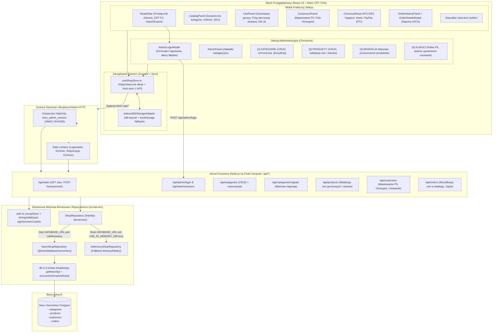

# Architektura Systemu — Shopping Cart (Retro CRT v3.0)

Dokument opisuje architekturę techniczną, wzorce projektowe, model danych oraz decyzje inżynieryjne wdrożone w wersji **v3.0** aplikacji **Shopping Cart**.

---

## 1. Przegląd Architektury i Założenia Projektowe

Aplikacja **Shopping Cart v3.0** została zaprojektowana w nowoczesnym modelu **Full-Stack Jamstack**:
- **Warstwa kliencka (SPA):** Reaktywna aplikacja React 19 zoptymalizowana pod kątem wydajności, działająca w estetyce zielonego terminala kineskopowego (Retro CRT), z lokalną pamięcią IndexedDB pełniącą funkcję odpornego cache'a i wsparcia offline.
- **Warstwa backendowa (Vercel Functions):** Bezserwerowe endpointy Node.js hostowane na platformie **Vercel** z wykorzystaniem silnika **Fluid Compute** (`vercel.json`), obsługujące standardowe interfejsy Web API `Request` / `Response`.
- **Warstwa danych (Neon Serverless Postgres):** Dedykowana baza relacyjna zarządzana przez sterownik `@neondatabase/serverless`, przechowująca relacje kategorii, produktów, klientów i zamówień.
- **Wzorzec Dual-Mode Repository:** Automatyczne przełączanie pomiędzy `NeonShopRepository` (produkcja/preview Vercel) a deterministycznym `InMemoryShopRepository` (testy Vitest, pipeline CI i lokalny rozwój bez bazy danych).
- **Zintegrowany Dev/Preview Plugin Vite (`viteApiPlugin`):** Umożliwia uruchamianie i testowanie endpointów `/api/*` bezpośrednio w procesie Node.js serwera Vite bez potrzeby odrębnego serwera backendowego.

---

## 2. Diagram Architektury Systemu (Mermaid)



---

## 3. Struktura Katalogów i Odpowiedzialność

```text
Shopping_cart/
├── api/                           # Bezserwerowe funkcje Vercel Functions (Web API)
│   ├── admin/                     # Endpointy sesji i logowania administratora
│   ├── categories/                # Endpointy kategorii oraz migracji asortymentu
│   ├── customers.ts               # Endpointy bazy klientów (maskowanie PII, honeypot)
│   ├── orders.ts                  # Endpointy składania i odczytu zamówień
│   ├── products.ts                # Endpointy katalogu produktów (walidacja groszy)
│   └── state.ts                   # Agregacja stanu startowego dla klienta
├── scripts/                       # Skrypty narzędziowe i operacje bazodanowe
│   ├── init-neon-db.mjs           # CLI: Inicjalizacja schematu tabel w Neon Postgres
│   └── init-neon-db.ts            # Skrypt TypeScript do zasilania bazy
├── src/
│   ├── domain/                    # Czysta domena biznesowa (0 zależności DOM/React)
│   │   ├── catalog.ts             # Dynamiczne kategorie, produkty, reasumpcja, migracja
│   │   ├── customer.ts            # Walidacja Zod, honeypot, unikalność e-mail, maskowanie PII
│   │   ├── money.ts               # Typ Cents, bezbłędny parser parsePlnInputToCents, formatPLN
│   │   ├── cart.ts                # Koszyk, próg darmowej dostawy (200 zł), syncCartWithCatalog
│   │   ├── payment.ts             # Algorytm Luhna, maskowanie kart (PCI-DSS), PayPal, Bitcoin
│   │   ├── exportTxt.ts           # Generator retro raportu tekstowego ASCII .txt
│   │   └── schemas.ts             # Schematy Zod dla stanu, walidacji API i backupów v1/v2/v3
│   ├── server/                    # Warstwa serwerowa współdzielona z api/
│   │   ├── auth.ts                # Autoryzacja scryptSync/timingSafeEqual, ciasteczka HMAC, limity
│   │   ├── db.ts                  # Leniwe połączenie getNeonSql() i migracja schematu SQL
│   │   ├── repository.ts          # Wzorzec repozytorium: NeonShopRepository + InMemoryShopRepository
│   │   └── viteApiPlugin.ts       # Mostek Vite przekierowujący /api/* do handlerów serwerowych
│   ├── components/                # Komponenty interfejsu użytkownika (React 19)
│   │   ├── AdminLoginModal.tsx    # Modal autoryzacji administratora
│   │   ├── AdminPanel.tsx         # Panel administracyjny (Kategorie, Produkty, Migracja, Klienci)
│   │   ├── CatalogPanel.tsx       # Katalog z filtrami kategorii, stanami magazynowymi
│   │   ├── CartPanel.tsx          # Panel koszyka z paskiem darmowej wysyłki
│   │   ├── CustomersPanel.tsx     # Rejestracja klientów, maskowanie PII, honeypot
│   │   ├── CheckoutPanel.tsx      # Kasa: Karta (bez CVV!), PayPal, Bitcoin
│   │   ├── OrderHistoryPanel.tsx  # Tabela zamówień i eksport raportów ASCII
│   │   ├── OrderDetailsModal.tsx  # Dostępny modal szczegółów zamówienia
│   │   ├── HeaderBar.tsx          # Pasek systemowy z dostępem do panelu admina
│   │   └── StatusBar.tsx          # Terminalowy pasek stanu (aria-live="polite")
│   ├── storage/                   # Adaptery pamięci masowej przeglądarki (IndexedDB)
│   ├── store/                     # Globalny stan aplikacji (Zustand + auto-synchronizacja)
│   └── styles/                    # Tokens CSS, scanlines kineskopowe i responsywny grid
├── tests/
│   ├── e2e/                       # Testy Playwright E2E + audyt dostępności Axe A11y
│   ├── integration/               # Testy integracyjne store, UI RTL i panelu admina
│   └── unit/                      # Testy jednostkowe domeny, serwera, auth i bazy
├── vercel.json                    # Konfiguracja Vercel: Fluid Compute + rewrites SPA
└── vite.config.ts                 # Konfiguracja Vite ze zintegrowanym viteApiPlugin
```

---

## 4. Finanse i Arytmetyka Groszy (`Cents`)

W aplikacjach finansowych stosowanie typu zmiennoprzecinkowego (`number` w JS, będącego 64-bitowym floatem IEEE 754) prowadzi do katastrofalnych błędów zaokrągleń (np. `0.1 + 0.2 === 0.30000000000000004`).

W architekturze v3.0 wdrożono rygorystyczny standard **arytmetyki całkowitoliczbowej w groszach**:
- Wszystkie wartości pieniężne (ceny produktów, sumy koszyka, koszt dostawy, kwoty zamówień) są przechowywane i przeliczane jako liczby całkowite reprezentujące grosze (`integer Cents`).
- Typ `Cents` jest typem brandowanym w TypeScript (`number & { readonly __brand: unique symbol }`), uniemożliwiającym przypadkowe podstawienie surowej liczby bez jawnej konwersji pomocniczej `toCents(val)`.
- **Parser wejścia użytkownika (`parsePlnInputToCents`):**
  Parsuje ciągi tekstowe z formularza (np. `"149.99"`, `"149,99"`, `"200"`) bez użycia mnożenia floatów: rozbija ciąg regexem na złotówki i grosze, uzupełnia brakujące cyfry zerami i sumuje jako liczby całkowite:
  $$\text{Cents} = (\text{złote} \times 100) + \text{grosze}$$
  Odrzuca wartości ujemne, puste lub posiadające więcej niż dwa miejsca po przecinku.
- **Konwersja z bazy Neon Postgres:**
  W bazie SQL kolumny `price_cents`, `subtotal_cents`, `delivery_cents`, `total_cents` posiadają typ `INTEGER`, gwarantując spójność z domeną TypeScript.
- **Prezentacja walutowa:** Funkcja `formatPLN(cents)` formatuje kwotę (np. `20000` -> `200,00 zł`) wyłącznie w warstwie prezentacji UI.

---

## 5. Warstwa Backendowa Vercel Functions (`/api/*` na Fluid Compute)

Backend aplikacji opiera się na **Vercel Functions** zoptymalizowanych pod kątem technologii **Fluid Compute**:
- Każdy plik w katalogu `api/` eksportuje nazwane funkcje obsługujące metody HTTP (`GET`, `POST`, `PUT`, `DELETE`).
- Handlery operują na natywnych standardach Web API: `Request` oraz `Response`, co czyni je w pełni przenośnymi.
- **Zintegrowany plugin lokalny (`viteApiPlugin`):**
  W środowisku lokalnym (`npm run dev` i `npm run preview`) Vite używa lekkiego middleware'a, który tłumaczy obiekty Node.js `IncomingMessage` i `ServerResponse` na standardowe Web API `Request` i `Response`, przekazuje je do handlerów w `api/` i odsyła nagłówki (w tym `Set-Cookie`). Dzięki temu środowisko deweloperskie i testy Playwright E2E działają identycznie jak w chmurze Vercel bez emulacji zewnętrznych serwerów!

---

## 6. Wzorzec Dual-Mode Repository

Architektura warstwy danych opiera się na wzorcu repozytorium zdefiniowanym przez interfejs `ShopRepository`:

```typescript
export interface ShopRepository {
  getState(isAdmin: boolean): Promise<ShopStatePayload>;
  getCategories(): Promise<Category[]>;
  createCategory(input: CreateCategoryInput): Promise<Category>;
  updateCategory(id: string, patch: UpdateCategoryInput): Promise<Category>;
  deleteCategory(id: string, targetCategoryId?: string): Promise<void>;
  migrateProducts(sourceCategoryId: string, targetCategoryId: string, productIds?: string[]): Promise<number>;
  getProducts(): Promise<Product[]>;
  createProduct(input: CreateProductInput): Promise<Product>;
  updateProduct(id: string, patch: UpdateProductInput): Promise<Product>;
  deleteProduct(id: string): Promise<void>;
  getCustomers(isAdmin: boolean): Promise<Customer[]>;
  createCustomer(input: RegisterCustomerInput): Promise<Customer>;
  deleteCustomer(id: string): Promise<void>;
  getOrders(): Promise<Order[]>;
  createOrder(input: CreateOrderInput): Promise<Order>;
  deleteOrder(id: string): Promise<void>;
  resetDemo(): Promise<void>;
  importState(state: PersistedShopState): Promise<void>;
}
```

### Implementacje:
1. **`NeonShopRepository`:**
   - Wykorzystywana automatycznie w środowisku z obecną zmienną `DATABASE_URL`.
   - Realizuje operacje bazodanowe w chmurze Neon Postgres za pomocą bezpiecznych szablonów zapytań SQL (`sql` tagged template) zapobiegających SQL Injection.
   - Weryfikuje i automatycznie inicjalizuje schemat tabel (`ensureSchemaAndSeed()`) przy pierwszym połączeniu.
2. **`InMemoryShopRepository`:**
   - Wykorzystywana, gdy zmienna `DATABASE_URL` nie jest zdefiniowana lub ustawiono `USE_IN_MEMORY_DB=true`.
   - Zapewnia 100% determinizm, szybkość i brak zależności sieciowych w testach jednostkowych (Vitest), środowisku CI GitHub Actions oraz lokalnym podglądzie offline.

---

## 7. Bezpieczeństwo Sesji Administracyjnej i Anty-Spam

### Serwerowa autoryzacja hasłem:
- Weryfikacja hasła administratora odbywa się wyłącznie na backendzie w `api/admin/login.ts`.
- Wykorzystuje kryptograficzną funkcję derywacji klucza `node:crypto` (`scryptSync`) z solą serwerową oraz porównanie w czasie stałym `crypto.timingSafeEqual`, co całkowicie eliminuje podatność na ataki typu timing attack.
- Hasło administratora pobierane jest ze zmiennej `ADMIN_PASSWORD`. W środowisku produkcyjnym brak zmiennej rzuca błąd konfiguracji (brak domyślnych haseł na produkcji!).

### Podpisany token sesji w ciasteczku `HttpOnly`:
- Po udanym logowaniu serwer generuje podpisany kryptograficznie token HMAC-SHA256 z wykorzystaniem klucza `ADMIN_SESSION_SECRET`.
- Token przesyłany jest w nagłówku `Set-Cookie` z rygorystycznymi atrybutami bezpieczeństwa:
  - `HttpOnly`: uniemożliwia odczyt tokenu przez jakikolwiek skrypt JavaScript (ochrona przed kradzieżą sesji przez XSS).
  - `SameSite=Strict`: uniemożliwia dołączenie ciasteczka w żądaniach cross-site (ochrona przed CSRF).
  - `Path=/`: token jest ważny w obrębie całej domeny aplikacji.
  - `Max-Age=7200`: ważność sesji ograniczona do 2 godzin.

### Ochrona przed atakami brute-force:
- Serwerowy limiter `checkRateLimit()` monitoruje próby logowania administratora: maksymalnie 5 błędnych prób w oknie 15 minut z danego adresu IP/sesji skutkuje kodem HTTP `429 Too Many Requests`.

---

## 8. Dynamiczny Katalog i Masowa Migracja Produktów

- **Gwarancja integralności (Invariable Default Category):**
  System posiada wbudowaną, niezmienną kategorię domyślną:
  `{ id: 'cat-default', name: 'Ogólne', isDefault: true }`.
  Próba usunięcia tej kategorii zwraca błąd walidacji domenowej `400 Bad Request`.
- **Automatyczna reasumpcja:**
  Przy usuwaniu dowolnej innej kategorii, repozytorium automatycznie aktualizuje wszystkie przypisane do niej produkty, reasumpując je do kategorii domyślnej `cat-default` (lub wskazanej `targetCategoryId`).
- **Masowa migracja produktów (`POST /api/categories/migrate`):**
  Umożliwia jednoczesne przeniesienie listy produktów ze wskazanej kategorii źródłowej do docelowej. Operacja na poziomie bazy SQL aktualizuje jednocześnie pola `category_id` oraz denormalizowaną nazwę `category`.

---

## 9. Ochrona Prywatności Klientów (PII Hygiene) i Anty-Spam

- **Publiczne maskowanie danych osobowych:**
  W widoku publicznym sklepu e-maile klientów są maskowane przez funkcję domenową `maskCustomerEmail`:
  `jan.kowalski@example.com` $\rightarrow$ `j***i@example.com`.
  Pełne dane klientów są udostępniane przez endpoint `GET /api/customers` **wyłącznie wtedy, gdy żądanie zawiera ważne ciasteczko sesji zalogowanego administratora**.
- **Przeniesienie akcji destrukcyjnych:**
  W publicznym komponencie `CustomersPanel` usunięto przycisk `USUŃ`. Usunięcie klienta (`DELETE /api/customers?id=...`) wymaga autoryzacji administratora; żądanie od niezalogowanego użytkownika zwraca kod `401 Unauthorized`.
- **Zabezpieczenie przed botami (Honeypot):**
  Formularz dodawania klienta zawiera niewidoczne dla człowieka pole `companyWebsite` (`tabIndex={-1}`, `aria-hidden="true"`, ukryte w stylach CSS). Wypełnienie tego pola przez automatycznego bota powoduje natychmiastowe odrzucenie żądania.
- **Unikalność e-maili i Rate Limiting:**
  System blokuje rejestrację zduplikowanych e-maili (`409 Conflict`) oraz ogranicza liczbę rejestracji do maksymalnie 5 na 10 minut na klienta (`429 Too Many Requests`).

---

## 10. Bezpieczeństwo Płatności i Standard PCI-DSS

- **Brak utrwalania kodów CVV/CVC:**
  Kod CVV weryfikowany jest wyłącznie w ulotnym stanie formularza React i nigdy nie trafia do modeli domenowych `Order`, bazy Neon Postgres, IndexedDB, plików backupu `data.json` ani raportów tekstowych `.txt`.
- **Maskowanie numerów kart kredytowych:**
  Po weryfikacji algorytmem Luhna numer karty jest nieodwracalnie anonimizowany do maski: `**** **** **** 1234`.
- **Weryfikacja cen po stronie serwera:**
  Podczas składania zamówienia (`POST /api/orders`) serwer pobiera aktualne ceny produktów bezpośrednio z bazy danych katalogu, uniemożliwiając manipulację kwotami w koszyku przez klienta w przeglądarce.

---

## 11. Architektura Testów i Zapewnienie Jakości

Projekt posiada trójwarstwową piramidę testów:
1. **Testy jednostkowe (Vitest):**
   - Warstwa domenowa (`src/domain/`): pokrycie > 98%.
   - Warstwa serwerowa (`src/server/`): testy autoryzacji, ciasteczek, repozytoriów i rate-limitingu.
2. **Testy integracyjne (React Testing Library + Vitest):**
   - Testy integracji komponentów UI (`AdminPanel`, `CustomersPanel`, `CatalogPanel`, `CartPanel`) ze stanem Zustand i operacjami domenowymi.
3. **Testy End-to-End (Playwright):**
   - Testowanie kompletnego przepływu na produkcyjnym serwerze preview: logowanie administratora, tworzenie kategorii, dodawanie produktów, masowa migracja, zakup towarów, weryfikacja zabezpieczeń API oraz audyt dostępności `@axe-core/playwright` (0 błędów krytycznych i poważnych).
