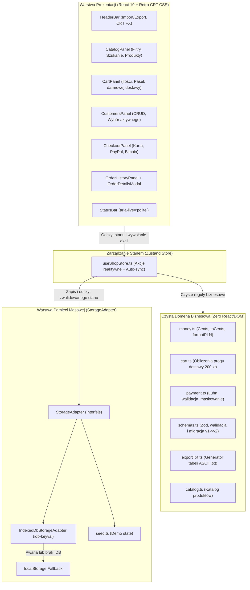
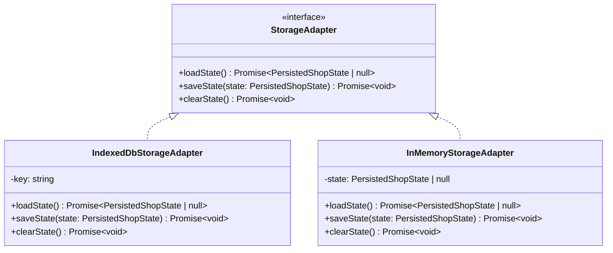

# Architektura Systemu — Shopping Cart (Retro CRT v2.0)

Dokument opisuje architekturę techniczną, wzorce projektowe, model danych oraz decyzje inżynieryjne wdrożone w wersji **v2.0** aplikacji **Shopping Cart**.

---

## 1. Przegląd Architektury i Założenia Projektowe

Aplikacja **Shopping Cart v2.0** została zaprojektowana w modelu **Client-First Single Page Application (SPA)**. Działa w 100% po stronie przeglądarki internetowej i nie wymaga zewnętrznego serwera backendowego ani bazy danych po stronie serwera. Całość jest serwowana jako statyczne pliki (HTML, CSS, JS) bezpośrednio z platformy **GitHub Pages**.

### Kluczowe cele architektoniczne:
1. **Niezależność domeny (Clean / Hexagonal Architecture):** Logika biznesowa jest całkowicie odseparowana od warstwy widoku Reacta i interfejsów przeglądarki (DOM, `window`, storage).
2. **Precyzja finansowa (Zero-Float Financial Arithmetic):** Całkowite wyeliminowanie błędów zaokrągleń zmiennoprzecinkowych IEEE 754 poprzez operowanie wyłącznie na liczbach całkowitych w groszach (`Cents`).
3. **Higiena bezpieczeństwa płatności (PCI-DSS Hygiene):** Kody CVV oraz pełne numery kart nigdy nie opuszczają ulotnej pamięci formularza walidacyjnego; w bazie i raportach zapisywane są wyłącznie zanonimizowane maski.
4. **Odporna persystencja i kompatybilność wsteczna:** Wykorzystanie IndexedDB z automatycznym fallbackiem do `localStorage` oraz mechanizmem migracji plików `data.json` ze starego klienta Tkinter (v1.0).
5. **Dostępność i estetyka Retro CRT:** Terminalowy klimat monitora kineskopowego z lat 80. połączony ze ścisłą zgodnością ze standardem dostępności WCAG AA oraz obsługą preferencji użytkownika (`prefers-reduced-motion`).



---

## 2. Struktura Katalogów i Podział Odpowiedzialności

```text
src/
├── domain/        # Czysta logika biznesowa (brak importów z Reacta, DOM, window, storage)
├── storage/       # Warstwa persystencji danych w przeglądarce
├── store/         # Stan globalny aplikacji (Zustand)
├── components/    # Reaktywne komponenty interfejsu użytkownika (React 19)
├── styles/        # System stylów i zmiennych CSS (Retro CRT Design System)
├── utils/         # Narzędzia pomocnicze (np. pobieranie plików w przeglądarce)
├── App.tsx        # Główny komponent orkiestrujący panele i boot screen
└── main.tsx       # Punkt wejścia aplikacji i montowanie w DOM
tests/
├── unit/          # Testy jednostkowe domeny, komponentów i adapterów (Vitest)
├── integration/   # Testy integracyjne store + storage oraz UI (React Testing Library)
└── e2e/           # Testy End-to-End w przeglądarce Chromium (Playwright + Axe A11y)
```

### Szczegółowy opis modułów:

| Moduł | Odpowiedzialność | Kluczowe pliki |
|---|---|---|
| **`src/domain/`** | Reguły kalkulacji cen, operacji na koszyku, walidacji Luhna/CVV/PayPal/BTC, schematy Zod, eksport ASCII `.txt`. Czysty TypeScript bez zależności zewnętrznych poza biblioteką Zod. | `money.ts`, `cart.ts`, `catalog.ts`, `payment.ts`, `schemas.ts`, `exportTxt.ts` |
| **`src/storage/`** | Abstrakcja warstwy persystencji. Odczyt i zapis stanu z IndexedDB (`idb-keyval`) z przezroczystym fallbackiem do `localStorage` oraz generowanie danych demonstracyjnych. | `adapter.ts`, `indexedDbAdapter.ts`, `inMemoryAdapter.ts`, `seed.ts` |
| **`src/store/`** | Centralny magazyn stanu aplikacji zrealizowany w Zustand (`useShopStore`). Integruje domenę ze storage, udostępnia metody akcji dla komponentów UI i zapewnia auto-persystencję po każdej mutacji. | `useShopStore.ts`, `index.ts` |
| **`src/components/`** | Dostępne komponenty terminalowe React 19: filtry, koszyk, dodawanie klientów, walidacja kasy, modal ze szczegółami, nagłówek z importem/eksportem oraz pasek statusu. | `CatalogPanel.tsx`, `CartPanel.tsx`, `CustomersPanel.tsx`, `CheckoutPanel.tsx`, `OrderHistoryPanel.tsx`, `OrderDetailsModal.tsx`, `HeaderBar.tsx`, `StatusBar.tsx` |
| **`src/styles/`** | System stylów bazujący na zmiennych CSS (tokens), responsywnym CSS Grid oraz opcjonalnej warstwie kineskopowych efektów CRT FX (scanlines, winieta, glow). | `tokens.css`, `crt.css`, `layout.css`, `global.css`, `index.css` |
| **`src/utils/`** | Funkcje pomocnicze niezwiązane z domeną, np. bezpieczne inicjowanie pobierania plików (`downloadTextFile`) przez dynamiczne tworzenie obiektów `Blob` i elementów kotwicy `<a>`. | `download.ts` |

---

## 3. Finanse i Arytmetyka Groszy (`Cents`)

W aplikacjach finansowych stosowanie typu zmiennoprzecinkowego (`number` w JavaScript będący 64-bitowym floatem IEEE 754) prowadzi do katastrofalnych błędów zaokrągleń (np. `0.1 + 0.2 === 0.30000000000000004` lub niedokładności przy wielokrotnych sumowaniach).

W architekturze v2.0 wdrożono bezwzględną regułę **arytmetyki całkowitoliczbowej w groszach**:
- Wszystkie wartości pieniężne (ceny produktów, sumy koszyka, koszt dostawy, kwoty zamówień) są przechowywane i przeliczane jako liczby całkowite reprezentujące grosze (`integer Cents`).
- Typ `Cents` jest typem brandowanym w TypeScript (`number & { readonly __brand: unique symbol }`), co zapobiega przypadkowemu przypisaniu surowej liczby bez jawnej konwersji pomocniczej `toCents(val)`.
- **Konwersja ze starego formatu `float` (legacy):** odbywa się wyłącznie przy imporcie danych za pomocą bezpiecznego zaokrąglenia `Math.round(pln * 100)`.
- **Prezentacja walutowa:** funkcja `formatPLN(cents)` formatuje grosze na czytelny łańcuch znaków (np. `20000` -> `200,00 zł`) wyłącznie w warstwie prezentacji.

### Parametry logistyki i dostawy:
- **Próg darmowej dostawy:** `20000` groszy (200,00 zł).
- **Koszt dostawy poniżej progu:** `1500` groszy (15,00 zł).
- **Kalkulacja kwoty do darmowej dostawy:** pole `amountToFreeDeliveryCents` zwraca `0` gdy subtotal osiągnie lub przekroczy 20 000 groszy, lub różnicę `20000 - subtotalCents` w przeciwnym razie. Gdy koszyk jest pusty, koszt dostawy wynosi `0 zł`.

---

## 4. Bezpieczeństwo Płatności i Higiena PCI-DSS

Aplikacja symuluje realizację transakcji z zachowaniem najwyższych standardów higieny bezpieczeństwa danych kartowych (zgodnie z duchem **PCI-DSS Level 1**):

### 1. Kody CVV/CVC:
- Kod CVV jest weryfikowany wyłącznie w pamięci operacyjnej podczas walidacji formularza w `CheckoutPanel` (oraz walidacji domenowej `validatePayment`).
- **Kod CVV jest natychmiast odrzucany i czyszczony z pamięci.**
- Nigdy nie jest przekazywany do modelu `Order`, store'a Zustand, bazy `IndexedDB`, `localStorage`, eksportu `data.json` ani tekstowego pliku `.txt`.

### 2. Pełne numery kart płatniczych:
- 16-cyfrowy numer karty przechodzi pełną weryfikację algorytmem Luhna (modulus 10) oraz sprawdzenie daty ważności (`MM/RR` nie starsza niż bieżący miesiąc).
- Po pomyślnej walidacji numer karty jest natychmiast anonimizowany za pomocą funkcji `maskCardNumber` do postaci:
  `**** **** **** 1234`
- Wyłącznie zamaskowany ciąg oraz 4 ostatnie cyfry (`last4`) są utrwalane w zamówieniu (`SafePaymentInfo`).

### 3. Alternatywne metody płatności:
- **PayPal:** Walidacja formatu adresu e-mail za pomocą ścisłego wyrażenia regularnego.
- **Bitcoin:** Walidacja poprawności adresu portfela w standardzie Base58 (legacy adresy rozpoczynające się od `1` lub `3`, długość 26–35 znaków) oraz Bech32 (natywne adresy SegWit rozpoczynające się od `bc1`, długość do 90 znaków). Wyliczanie ekwiwalentu w BTC w oparciu o stałą referencyjną `BTC_RATE_PLN = 400 000 zł`.

---

## 5. Warstwa Persystencji (Storage) i Migracja Danych



### Mechanizm zapisu i fallback:
1. Podstawową technologią pamięci masowej w przeglądarce jest **IndexedDB**, obsługiwana za pośrednictwem biblioteki `idb-keyval`.
2. Przy próbie zapisu lub odczytu adapter sprawdza dostępność IndexedDB (`isIndexedDbAvailable()`). W przypadku zablokowania IndexedDB (np. w restrykcyjnych trybach incognito, sandboxed iframes) adapter automatycznie i bezgłośnie przełącza się na `localStorage`.
3. Przy każdym odczycie dane poddawane są ścisłej walidacji za pomocą schematu Zod `PersistedShopStateSchema`. Jeśli dane w pamięci podręcznej są uszkodzone, system bezpiecznie ładuje stan demonstracyjny (`seed.ts`).

### Migracja formatu Legacy (`data.json`):
Funkcja `parseLegacyOrCurrentBackup(jsonString)` w `src/domain/schemas.ts` umożliwia bezproblemowy import zarówno nowoczesnego backupu v2, jak i historycznego pliku `data.json` generowanego przez klienta Tkinter v1:
- Ceny i sumy zapisane w formacie `float` (np. `79.99`) są automatycznie przeliczane na grosze: `toCents(Math.round(pln * 100))`.
- Niezamaskowane numery kart ze starych baz są poddawane natychmiastowej masce `**** **** **** 1234`.
- Ewentualne jawne pola `cvv` obecne w historycznych plikach są usuwane.

### Niezależność relacji Klient — Zamówienie:
W modelu relacyjnym usunięcie klienta mogłoby spowodować kaskadowe usunięcie lub błędy kluczy obcych w historii zamówień. W architekturze v2 zastosowano wzorzec **Customer Snapshot**:
- Każde zamówienie (`Order`) przechowuje wewnątrz własny niezależny obiekt klienta (`customer: { id, name, email }`) z momentu zakupu.
- Dzięki temu usunięcie klienta z listy w panelu klientów nie narusza integralności ani czytelności historycznych zamówień.

---

## 6. Architektura UI Retro CRT i Dostępność (WCAG AA)

### Design System i Paleta Barw:
Interfejs bazuje na estetyce monochromatycznych zielonych monitorów terminalowych (P1 phosphor):
- **Tło główne:** `#0b0f0b` (głęboka czerń terminalowa)
- **Panele i sekcje:** `#0f1a10`
- **Tekst główny:** `#21f35a` (jasna zieleń luminoforu)
- **Akcenty i aktywne kontrolki:** `#00ff66`
- **Ostrzeżenia i alerty:** `#ffb000` (bursztyn)
- **Błędy:** `#ff4d4d` (karminowy)
- **Typografia:** Rodzina czcionek o stałej szerokości znaku (`Courier New`, `Fira Code`, `monospace`).

### Warstwa CRT FX:
- Efekty scanlines (poziome linie kineskopu) oraz poświata (glow) tekstu i kontenerów są realizowane w pliku `src/styles/crt.css` za pomocą pseudoelementów `::before` i `::after` z `pointer-events: none`.
- Użytkownik może w każdej chwili wyłączyć efekty przełącznikiem `[CRT FX: ON/OFF]` na pasku nagłówka. Ustawienie to jest natychmiast utrwalane w konfiguracji aplikacji (`settings.crtFx`).
- **Obsługa preferencji dostępności:** Aplikacja automatycznie wyłącza animacje i poświaty oraz zmniejsza kontrast scanlines w reakcji na regułę CSS:
  ```css
  @media (prefers-reduced-motion: reduce) { ... }
  ```

### Standardy Dostępności (WCAG AA):
- Pełna obsługa klawiatury: logiczna kolejność tabulacji, wyraźne i kontrastowe wskaźniki fokusu (`:focus-visible`).
- Modal szczegółów zamówienia wyposażony w pułapkę fokusu, możliwość zamknięcia klawiszem `Esc` oraz poprawne atrybuty `role="dialog"`, `aria-modal="true"` i `aria-labelledby`.
- Dolny pasek statusu terminala posiada semantyczny atrybut `role="status"` oraz `aria-live="polite"`, dzięki czemu czytniki ekranu informują użytkownika o zmianach stanu bez przerywania bieżącej lektury.
- Zgodność potwierdzona automatycznym audytem biblioteki `@axe-core/playwright` (zero naruszeń o statusie `critical` i `serious`).

---

## 7. Strategia Testów i Weryfikacja Jakości

Projekt stosuje rygorystyczną piramidę testów:

```text
               /\
              /  \     E2E Tests (10 scenariuszy Playwright)
             /    \    - Prawdziwa przeglądarka Chromium na buildzie produkcyjnym
            /------\   - Skan dostępności @axe-core/playwright, reload, eksport .txt
           /        \
          /----------\  Integration Tests (Vitest + RTL + Zustand)
         /            \ - Integracja store + storage, testy komponentów UI
        /--------------\
       /                \ Unit Tests (Vitest)
      /------------------\- Czysta domena: money, cart, payment, schemas, exportTxt
```

- **Unit tests:** 203 testy jednostkowe i integracyjne Vitest w 25 plikach testowych.
- **Pokrycie kodu (Code Coverage v8):**
  - Warstwa domenowa (`src/domain/`): **> 98%** linii kodu.
  - Całość aplikacji (`src/`): **> 96%** linii kodu.
- **Testy E2E (Playwright):** 10 scenariuszy uruchamianych na produkcyjnym serwerze `vite preview` pod ścieżką `/Shopping_cart/`:
  1. Ładowanie aplikacji pod `/Shopping_cart/` bez błędów konsoli i błędnych statusów HTTP (zero 404).
  2. Wyszukiwanie, filtrowanie i dodawanie pozycji do koszyka.
  3. Dynamiczna zmiana kosztu dostawy (`15.00 zł` -> `GRATIS` po przekroczeniu `200.00 zł`).
  4. Dodawanie, wybór i bezpieczne usuwanie klienta bez niszczenia zamówień.
  5. Walidacja negatywna i pozytywna 3 metod płatności, maskowanie kart i weryfikacja braku CVV.
  6. Odporność i trwałość zamówień w IndexedDB po odświeżeniu strony (`page.reload()`).
  7. Zamknięcie modala klawiszem `Esc` oraz weryfikacja pobranego raportu ASCII `.txt`.
  8. Eksport i import pliku kopii zapasowej JSON.
  9. Persystencja przełącznika `CRT FX` oraz brak poziomego scrolla na widoku mobilnym (`390x844`).
  10. Skan dostępności axe-core w widoku głównym i oknie modalnym.

---

## 8. CI/CD i Infrastruktura Wdrożeniowa

- **Platforma hostingowa:** GitHub Pages (`base: '/Shopping_cart/'`).
- **Workflow GitHub Actions:** `.github/workflows/ci-deploy.yml`:
  - **Job `verify`:** Uruchamiany przy każdym `push` i `pull_request` do gałęzi `master`/`main`. Wykonuje pełny łańcuch weryfikacyjny:
    `npm ci` ➔ `npm run lint` ➔ `npm run format:check` ➔ `npm run typecheck` ➔ `npm run test:coverage` ➔ `npx playwright install chromium` ➔ `npm run test:e2e` ➔ `npm run build`.
  - **Job `deploy`:** Uruchamiany automatycznie po zakończeniu sukcesem joba `verify` (wyłącznie na gałęzi produkcyjnej), wdrażający skompilowany katalog `dist/` do GitHub Pages za pomocą akcji `actions/deploy-pages@v4`.
- **Obsługa routingu:** Plik `public/404.html` ze skryptem przekierowującym SPA zapobiega problemom ze statycznym serwowaniem podstron na GitHub Pages.
